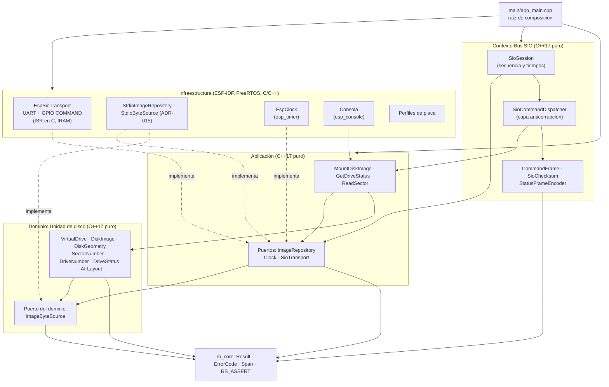
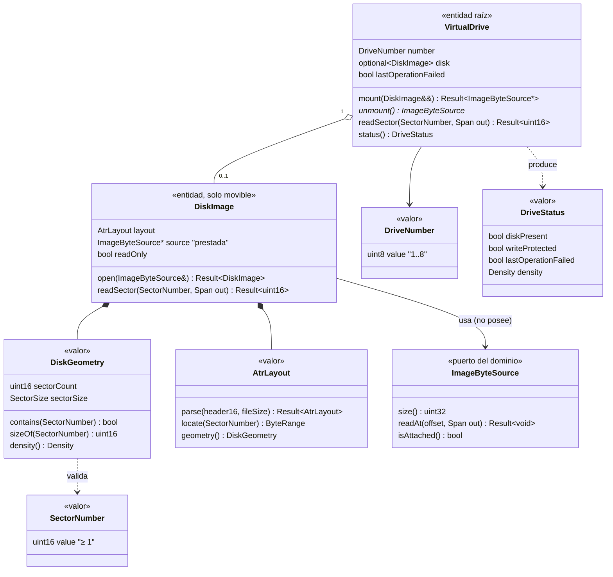
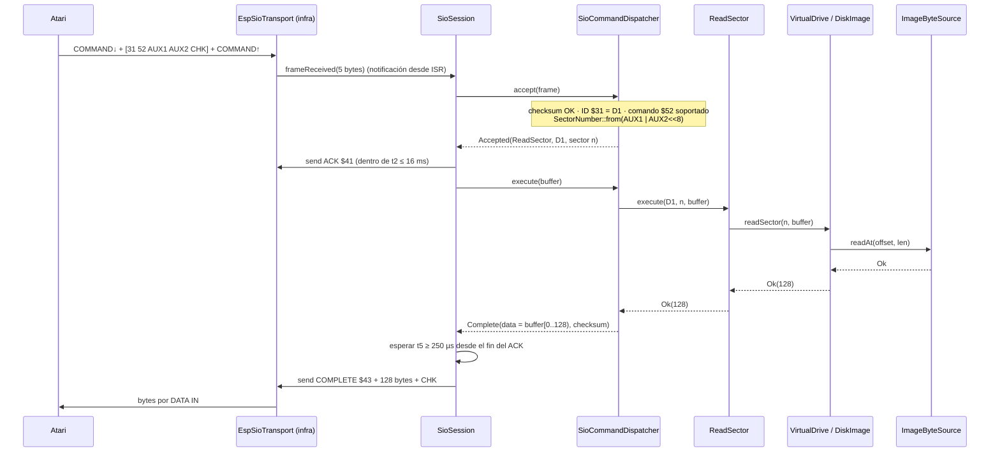

# RetroBridge Chile — Arquitectura inicial (propuesta v0.2)

> Estado: **APROBADA** (2026-10-23): decisiones D-1 a D-13 aprobadas tal como se proponen en §12.
> Implementación:
> - **H0** (PR #1, fusionado en `main`, `6b18e41`): esqueleto ESP-IDF, componentes iniciales, pruebas de host y CI.
> - **H1** (PR #2, fusionado en `main`, `81dc471`): `rb_core` y dominio Atari XL/XE (objetos de valor, `AtrLayout`,
>   `DiskImage`, `VirtualDrive`), enmienda del ADR-002 y reglas de propiedad de §3.4.
> - **H2a** (PR #3, fusionado en `main`, `5a9d45a`): capa de aplicación y recursos. Incluye `ImageLocation`,
>   `ImageRepository` y `DriveMailbox`, `DriveBay` y los casos de uso en dos contextos (ADR-014).
> - **H2b** (PR #4, fusionado en `main`, `6cfb036`): protocolo SIO puro. Incluye `sio_checksum`, `CommandFrame`,
>   `StatusFrameEncoder`, `SioCommandDispatcher`, y `VirtualDrive::validateRead`/`geometry`.
> - **H2c** (PR #5, fusionado en `main`, `7f56f4f`): `SioSession`, puertos `Clock` y `SioTransport`, recuperación
>   ante errores de transporte (`SioCommandDispatcher::abandon`) y temporización simulada.
> - **H3a** (PR #6, fusionado en `main`, `0e1c6be`): adaptador de archivos portable `rb_file_storage` (ADR-015),
>   herramientas `make_atr.py` y `compare_crc.py`, y Meta A en el host.
> - **H3b** (PR #7, fusionado en `main`, `b3816f9`):
>   - diagnóstico portable (`InspectImage`, `VerifySectors`, `BenchmarkReads`, `LatencyStats`);
>   - `rb_board` (perfil `RB_BOARD_UNCONFIRMED` por defecto y validador de GPIO);
>   - `InlineDriveMailbox`;
>   - `rb_esp_platform`, `rb_esp_storage` (montaje bloqueado sin placa confirmada) y `rb_console`, que en el ESP32
>     solo se compilan.
> - **H3c, preparación** (PR #8, fusionado en `main`, `13c708d`):
>   - identificación del hardware (`docs/hardware/fujinet-atari-v1x.md`). La revisión quedó confirmada después
>     (PR #9, `1b1527d`): **FN32ROV-1.3-Q24** con ESP32-WROVER-B, por fotografías;
>   - perfil de microSD `fujinet-atari-v1.3/1.5` (SPI3, sin pines SIO), **no predeterminado**;
>   - tabla de particiones propia de 16 MB;
>   - procedimiento de instalación y recuperación.
> - **H3c, artefacto de firmware** (PR #10, `d39093a`): job `firmware-package`, que compila y verifica el firmware
>   `1b1527d` con el perfil de la placa.
> - **H3c, validación física** (2026-10-24; rama `docs/h3c-validacion-fisica-2026-10-24`, en revisión): firmware
>   `1b1527d` instalado en la placa con respaldo previo D5/D6; **Meta A cumplida en el equipo** (4 640/4 640 CRC32)
>   (`docs/mediciones/h3c-validacion-fisica-2026-10-24.md`).
> - **H4, preparación documental** (rama `docs/h4-puerta-hardware-sio`, en revisión; **H4 no aprobado**):
>   pinout y adaptación eléctrica verificados en el esquema 1.3, riesgos, procedimiento de medición pasiva y
>   checklist (`docs/hardware/h4-puerta-sio.md`); diseño preliminar de H5 solo recepción
>   (`docs/diseno/h5-escucha-solo-recepcion.md`).
> - **H4, paquete de diagnóstico** (PR #14, fusionado en `main`, `ded3710`): job independiente
>   `firmware-package-h4`, que empaqueta `15b153f` como `retrobridge-fw-diag-fujinet-atari-v1x-15b153f`; el paquete
>   H3c no cambia.
> - **H4, regresión de H3c** (2026-10-25; rama `docs/h4-regresion-h3c-2026-10-25`, en revisión): con el firmware
>   `15b153f`, sin volver a flashear, se reprodujo la Meta A (4 640/4 640 CRC32), la unidad D1 y los benchmarks
>   (`docs/mediciones/h4-regresion-h3c-2026-10-25.md`). `OtherWatchdog` de arranque reiterado y pendiente.
> - **H4, validación física del diagnóstico** (2026-10-24; PR #15, fusionado en `main`, `8660f50`): firmware
>   `15b153f` (ejecución `40133891881`) en la placa, solo por USB y sin el Atari. `rb_hw_diag` validado
>   funcionalmente y `diag report` verificado con `check_diag_report.py`
>   (`docs/mediciones/h4-validacion-diagnostico-2026-10-24.md`). **H4 eléctrico sigue en preparación.**
> - **H4, diagnóstico autónomo** (PR #13, fusionado en `main`, `7ae22ea`): componente puro
>   `rb_hw_diag` (reinicios, watchdog, memoria, microSD, errores de lectura, latencias y eventos) con el adaptador
>   `EspSystemProbe` y el comando de consola `diag`; sin GPIO del SIO ni ADC
>   (`docs/diseno/h4-diagnostico-autonomo.md`).
> - Aún **no** se han implementado los adaptadores UART/GPIO del SIO, y el SIO no se ha probado con un Atari.
> Fecha: 2026-10-23. Reemplaza a la v0.1 del mismo día.
> Repositorio: `calaluis/retrobridge-chile` (privado por ahora). Licencia: GPL-3.0-only (ADR-013).
> Las firmas de clases que aparecen aquí son **notación de diseño**, no implementación.

## Cambios respecto de v0.1

- Lenguaje principal C++17 (C solo para controladores de bajo nivel e integración con APIs C de ESP-IDF).
- Arquitectura hexagonal con capas Dominio / Aplicación / Infraestructura y DDD ligero (§2, §3).
- Modelo de dominio explícito con invariantes (§3), casos de uso (§4) y puertos mínimos (§5).
- SOLID con criterios de verificación (§7) y registro de decisiones ADR (§8).
- Restricciones embebidas: sin excepciones ni RTTI, sin heap en la ruta crítica, ISR sin llamadas virtuales (§9).
- Se elimina la afirmación de "sala limpia": se reemplaza por una política de desarrollo independiente con
  trazabilidad de fuentes (§0).

---

## 0. Alcance, procedencia y licencias

### 0.1 Alcance de la v1 (sin cambios)

Atari XL/XE · ESP32 · unidad **D1** · imagen **ATR local en microSD** · **solo lectura** · comandos **STATUS**
(`$53`) y **READ SECTOR** (`$52`). Atari 2600, Wi-Fi, TNFS/TCP y TNFS/WSS quedan para etapas futuras: el diseño
deja el punto de extensión (§5.3), pero no se implementa ningún adaptador de red.

### 0.2 Desarrollo independiente y trazabilidad

- **No afirmamos un procedimiento formal de sala limpia.** Hay experiencia previa con el firmware original de
  FujiNet, y no podemos demostrar aislamiento.
- Lo que sí aplicamos y podemos demostrar:
  1. No se copia, traduce ni adapta código fuente de FujiNet ni de otros emuladores de periféricos SIO.
  2. El diseño se basa en documentación pública de protocolos, especificaciones de hardware y documentación oficial
     de ESP-IDF, registradas en §12 y en `docs/fuentes.md`.
  3. Cada PR declara las fuentes consultadas para ese cambio (plantilla de PR).
  4. Las decisiones de diseño quedan registradas en ADR (§8), con su justificación propia.
- El historial de git y los ADR sirven como evidencia de la evolución independiente del diseño.

### 0.3 Licencias

- `LICENSE`: texto oficial completo de la **GNU GPL versión 3** para **nuestro** código (`GPL-3.0-only`). El
  titular del código propio figura en el aviso de copyright del [README](../README.md#license).
- `THIRD_PARTY_NOTICES.md`, **separado**: avisos de dependencias (ESP-IDF, Apache-2.0; FatFs; Unity, MIT; y las
  que se agreguen). Cada nueva dependencia actualiza este archivo en el mismo PR.
- Recomendación: validar con asesoría legal la redacción de ambos archivos.

---

## 1. Fundamentos técnicos (resumen de v0.1)

**Bus SIO** (manual técnico de Atari C016555, secciones 9 y K):

- Serie asíncrona de ~19 200 baudios, 8N1, LSB primero.
- Trama de comando de 5 bytes con COMMAND en bajo: `[ID][CMD][AUX1][AUX2][CHK]`.
- El checksum es la suma de los bytes con el acarreo reinyectado.
- Respuestas: ACK `$41`, NAK `$4E`, COMPLETE `$43`, ERROR `$45`.
- Las unidades de disco usan los ID `$31` en adelante (D1 = `$31`).
- La salida del periférico es de colector abierto.
- El pin 10 (+5V/READY) entrega como máximo 50 mA.

**Tiempos (lado computador):**

| Tiempo | Significado | Mín | Máx |
|---|---|---|---|
| t0 | COMMAND↓ → primer byte | 750 µs | 1600 µs |
| t1 | Último bit → COMMAND↑ | 650 µs | 950 µs |
| t2 | COMMAND↑ → ACK | 0 | 16 ms |
| t3 | ACK → datos del computador | 1000 µs | 1800 µs |
| t4 | Fin de datos → ACK | 850 µs | 16 ms |
| t5 | ACK → COMPLETE | 250 µs | 255 s (depende del controlador) |

**Formato ATR:**

- Cabecera de 16 bytes con magia `$0296`, tamaño en párrafos de 16 bytes (más un byte alto) y tamaño de sector de
  128 o 256 bytes.
- En imágenes DD, los tres primeros sectores normalmente miden 128 bytes.

Los requisitos de hardware a confirmar (§3 de la v0.1) se mantienen íntegros en el **Anexo A**.

---

## 2. Arquitectura y dirección de dependencias

### 2.1 Capas y contextos



**Regla de dependencia:** las flechas apuntan siempre hacia el dominio.

- `rb_domain` depende solo de `rb_core`. Puede definir sus propios puertos de salida (hoy, `ImageByteSource`)
  siempre que dependan solo de `rb_core` (enmienda H1 del ADR-002).
- `rb_application` depende de `rb_domain` y `rb_core`.
- `rb_sio` depende de `rb_application`.
- Infraestructura depende de todo lo anterior; nada depende de infraestructura salvo `main`.
- Ningún componente puro incluye cabeceras de ESP-IDF, FreeRTOS, FATFS ni sockets.

### 2.2 Contextos delimitados (DDD ligero)

| Contexto | Tipo | Responsabilidad | Lenguaje propio |
|---|---|---|---|
| **Unidad de disco** | Núcleo | Qué es una unidad virtual, qué disco tiene, qué sectores existen y cuál es su estado | unidad, disco, imagen, sector, geometría, densidad, montar, solo lectura |
| **Bus SIO** | Soporte | Tramas, checksum, códigos de respuesta, tiempos del bus | trama de comando, ID de dispositivo, ACK/NAK/COMPLETE/ERROR, t0–t5 |
| **Almacenamiento de imágenes** | Genérico | Obtener bytes de una imagen desde algún medio (microSD hoy, TNFS mañana) | ubicación de imagen, fuente de bytes, repositorio |

**Mapa de contextos:**

- *Bus SIO → Unidad de disco:* `SioCommandDispatcher` actúa como **capa anticorrupción**. Traduce
  `CommandFrame` (ID `$31`, comando `$52`, AUX1/AUX2) a conceptos de dominio (`DriveNumber{1}`, `SectorNumber{n}`)
  e invoca casos de uso. El dominio nunca ve bytes de protocolo.
- *Unidad de disco → Almacenamiento:* a través de `ImageByteSource`, un puerto que define el dominio, y de
  `ImageRepository`, un puerto de la capa de aplicación. El dominio no sabe si los bytes vienen de FATFS o de la red.

### 2.3 Glosario (lenguaje ubicuo)

La documentación va en español y los identificadores en inglés (decisión D-11). Este glosario es la tabla de
correspondencia.

| Término | Identificador | Definición |
|---|---|---|
| Unidad | `VirtualDrive` | Unidad de disco emulada D1…D8 que el Atari direcciona |
| Número de unidad | `DriveNumber` | 1…8; D1 = 1 |
| Imagen de disco | `DiskImage` | Disco "insertado": geometría + disposición + fuente de bytes |
| Geometría | `DiskGeometry` | Cantidad de sectores y tamaño de cada uno |
| Número de sector | `SectorNumber` | Sector lógico, base 1 |
| Densidad | `Density` | Simple (720×128), media (1040×128), doble (720×256) o no estándar |
| Estado de unidad | `DriveStatus` | Situación observable de la unidad que el Atari consulta con STATUS |
| Montar | `MountDiskImage` | Insertar una imagen en una unidad |
| Trama de comando | `CommandFrame` | 5 bytes enviados con COMMAND en bajo |
| Fuente de bytes | `ImageByteSource` | Acceso aleatorio de solo lectura a los bytes de una imagen |

---

## 3. Modelo de dominio Atari XL/XE

### 3.1 Evaluación de los conceptos propuestos

| Concepto propuesto | Decisión | Justificación |
|---|---|---|
| `VirtualDisk` | **Renombrar a `VirtualDrive`** (D-1) | En el lenguaje Atari, el Atari habla con una *unidad* (D1); el *disco* es lo que se inserta. "VirtualDisk" se confundiría con `DiskImage`. La unidad tiene identidad (D1) y ciclo de vida (vacía ↔ con disco): es la entidad raíz. |
| `SectorNumber` | **Se adopta**, objeto de valor | Evita el error más común (sector 0, confusión base 0/base 1) y concentra la validación. |
| `DiskGeometry` | **Se adopta**, objeto de valor | Concentra la regla de "tres primeros sectores de 128 bytes" y la densidad; sin ella, esa lógica se dispersaría. |
| `DriveStatus` | **Se adopta**, objeto de valor | Representa el estado en términos de dominio. La codificación a 4 bytes pertenece al contexto SIO (`StatusFrameEncoder`), porque es un detalle del protocolo. |
| `DiskImage` | **Se adopta**, entidad subordinada, **clase concreta** | Une geometría, disposición en el archivo y fuente de bytes. **No** se define una interfaz `DiskImage` mientras ATR sea el único formato (ADR-007). |
| `DriveNumber` | **Se agrega**, objeto de valor | Necesario para direccionar D1…D8 sin enteros sueltos; habilita varias unidades en el futuro sin cambiar firmas. |
| `AtrLayout` | **Se agrega**, objeto de valor | Traduce `SectorNumber` → (desplazamiento, longitud) dentro del archivo ATR y valida la cabecera. Es conocimiento puro del formato ATR, que forma parte del lenguaje del dominio Atari. |
| `Density` | **Se agrega**, enumeración | Se deriva de la geometría y se usa en el estado de la unidad. |
| `DriveBay` | **Se agrega**, contenedor de aplicación | Arreglo fijo de `VirtualDrive` (capacidad 1 en la v1). No es un repositorio con persistencia: solo da acceso por `DriveNumber` sin usar heap. |

Conceptos **descartados** por ahora:

- `Sector` como entidad: un sector es un rango de bytes; un `Span` basta.
- `DiskImageFactory` como clase: es una función de `AtrLayout`.
- Eventos de dominio: no hay consumidores en la v1.

### 3.2 Diagrama



### 3.3 Responsabilidades e invariantes

**`SectorNumber`** (valor)

- Invariante: `value ≥ 1`.
- Se construye solo con `SectorNumber::from(uint16_t) → Result<SectorNumber>`; no hay constructor público que
  acepte 0.
- No sabe si el sector existe en un disco concreto: eso lo valida `DiskGeometry`.

**`DriveNumber`** (valor)

- Invariante: `1 ≤ value ≤ 8`.
- La correspondencia con el ID SIO (`$30 + n`) **no** vive aquí: es del contexto SIO.

**`DiskGeometry`** (valor)

- Invariantes:
  - `sectorCount ≥ 1` (decisión D-7: si se exige `≥ 3` para discos arrancables).
  - `sectorSize ∈ {128, 256}` en la v1.
- `contains(n)` ⇔ `n ≤ sectorCount`.
- `sizeOf(n)` devuelve 128 si `n ≤ 3` o si `sectorSize = 128`; en otro caso devuelve `sectorSize`.
- `density()` se deriva: 720×128 → simple, 1040×128 → media, 720×256 → doble; cualquier otra combinación → no
  estándar.
- Inmutable.

**`AtrLayout`** (valor)

- `parse()` acepta la cabecera solo si la magia es `$0296` y el tamaño de sector es válido.
- La cantidad de sectores se calcula desde el tamaño **real** de la fuente, no desde la cabecera (D-8, precisada
  en H1-3):
  - Los datos son el tamaño del archivo menos 16 bytes de cabecera, en ambas direcciones.
  - `headerSizeMismatch()` informa si la cabecera declara otra cosa, y `ignoredTrailingBytes()` informa cuántos
    bytes de un sector final incompleto se ignoraron. El dominio no registra eventos: la advertencia la emite la
    capa de aplicación.
- `locate(n)`, con H = 16:
  - si `n ≤ 3`: desplazamiento = `H + (n−1)·128`;
  - si no: desplazamiento = `H + 3·128 + (n−4)·sectorSize`, en imágenes DD con sectores cortos.
- D-6, precisada en H1-4: con sectores de 256 bytes y al menos 384 bytes de datos, se exige `datos % 256 ≠ 0`. El
  formato estándar (3×128 + n×256) siempre deja resto 128. Un múltiplo exacto de 256 corresponde a la variante con
  sectores de arranque de 256 bytes y se rechaza con `UnsupportedAtrLayout`. Un DD estándar seguido exactamente de
  128 bytes sobrantes cae en el mismo caso y también se rechaza, porque es indistinguible.
- Se rechaza con `ImageTooSmall` una imagen sin ningún sector completo, o un archivo de menos de 16 bytes.
- Se rechaza con `ImageTooLarge` una imagen de más de 65 535 sectores (H1-5).
- Invariante: todo `ByteRange` devuelto cabe dentro del tamaño de la fuente. La aritmética usa `uint32_t` sin
  posibilidad de desbordamiento.

**`DiskImage`** (entidad)

- Identidad: forma parte del agregado `VirtualDrive` y no tiene identidad propia. Su `ImageLocation` (ruta en la SD
  hoy, URL TNFS mañana) la guarda `DriveBay` junto a cada unidad, no `DiskImage` (H2-10). Así las interfaces de H1
  no cambian.
- Solo se crea con `DiskImage::open(ImageByteSource&)`, que lee y valida la cabecera (H1-1).
- Invariantes:
  - Geometría y disposición son coherentes con el tamaño de la fuente.
  - `readOnly = true` en la v1, sin excepción.
- **No posee** la fuente de bytes: la toma prestada. Las reglas están en §3.4.

**`VirtualDrive`** (entidad raíz)

- Identidad: `DriveNumber`.
- Estados: *vacía* o *con disco*.
- Invariantes:
  - `readSector` sobre una unidad vacía → `ErrorCode::NoDiskMounted`.
  - Un sector fuera de la geometría → `ErrorCode::SectorOutOfRange`, sin tocar la fuente.
  - El búfer de salida debe medir al menos `geometry.sizeOf(n)`; si no → `ErrorCode::BufferTooSmall`.
  - Cada operación actualiza `lastOperationFailed`, que se refleja en `status()`.
  - Montar sobre una unidad ocupada reemplaza el disco: es un desmontaje implícito. `mount` y `unmount` devuelven
    la fuente desplazada, ya desvinculada, para que la capa de aplicación la cierre una sola vez (H1-8, §3.4).
  - `mount` y `unmount` reinician `lastOperationFailed`.
  - No es copiable ni movible: es una entidad con identidad fija.
  - Consultas en memoria para la fase 1 del despachador (H2b). No hacen E/S ni modifican `lastOperationFailed`:
    - `validateRead(n)` devuelve el tamaño del sector, `NoDiskMounted` o `SectorOutOfRange`;
    - `geometry()` devuelve la geometría del disco montado, o `nullptr` con la unidad vacía.

    Son adiciones compatibles: ninguna firma de H1 cambia.
- No conoce bytes de protocolo, tiempos, UART ni archivos.

**`DriveStatus`** (valor)

- Instantánea inmutable que produce `VirtualDrive::status()`.
- El significado bit a bit de los 4 bytes de la respuesta STATUS se decide en el encoder SIO, una vez confirmado
  con documentación de la 810/1050 (D-5).
- En la v1, `writeProtected` es siempre `true`. Con la unidad vacía, `density` es `Unknown` (H1-6).

### 3.4 Propiedad y vida útil de `DiskImage` e `ImageByteSource` (H1-8)

**Quién posee qué:**

- **La fuente:** la posee quien la crea. En producción es un slot de memoria estática del repositorio (H2/H3); en
  las pruebas, la propia prueba.
- **`DiskImage`:** guarda un puntero **prestado**.
- **`VirtualDrive`:** posee su `DiskImage` en línea, dentro de un `std::optional`, sin heap.

**Mecanismo:** `ImageByteSource` tiene una marca `attached` que solo modifica `DiskImage` (clase amiga).

- Una fuente está *vinculada* exactamente mientras un `DiskImage` vivo la referencia.
- `DiskImage` es solo movible:
  - mover transfiere el vínculo y deja el origen inválido;
  - destruirlo, o asignar otro encima, desvincula su fuente.

| Riesgo | Protección | Prueba |
|---|---|---|
| 1. Montar dos veces la misma instancia | `DiskImage::open` rechaza una fuente vinculada (`SourceInUse`), así que una fuente respalda a lo más un `DiskImage`, en cualquier unidad. | `test_source_cannot_back_two_images`, `test_mounted_source_cannot_be_opened_again` |
| 2. Cerrar una fuente en uso | `isAttached()` es verdadero mientras está montada. El contrato de `ImageRepository::close` (H2) prohíbe cerrar una fuente vinculada y lo comprobará con `RB_ASSERT`, porque sería un error de programación. `mount` y `unmount` solo devuelven fuentes ya desvinculadas. | `test_source_stays_attached_while_mounted`, `test_mounting_over_a_disk_returns_the_detached_previous_source` |
| 3. Duplicar referencias al copiar | `DiskImage` no es copiable; `Result<DiskImage>` tampoco. Se comprueba en compilación. | `static_assert` en `test_disk_image.cpp`; `test_move_transfers_the_attachment` |
| 4. Usar una fuente liberada o reutilizada | Una fuente solo queda desvinculada cuando ningún `DiskImage` la referencia. Tras `unmount`, la unidad ya no la toca. Un `DiskImage` movido devuelve `InvalidDiskImage` sin leer. | `test_unmounted_source_is_never_read_again`, `test_moved_from_image_refuses_reads`, `test_destruction_detaches_the_source` |

**Ciclo de vida completo** (implementado en H2a, ADR-014). Hay dos contextos, cada uno dueño de sus recursos:

| Paso | Contexto | Acción |
|---|---|---|
| 1 | Almacenamiento | `MountDiskImage`: `repository.open(location)`, luego `DiskImage::open`. Si falla, cierra la fuente y termina. |
| 2 | Almacenamiento | `mailbox.submit(DriveRequest::mount(...))`. Con `MailboxBusy`, desvincula el `DiskImage`, cierra la fuente y termina (montaje cancelado). |
| 3 | Unidad | `ApplyDriveRequest`: `bay.mount(...)`. Si tiene éxito, la fuente desplazada va en `displaced`; si la unidad no existe, el disco se desvincula y su fuente va en `rejected`. Envía `putReply`. No usa el repositorio. |
| 4 | Almacenamiento | `CollectDriveReply`: cierra `displaced` y `rejected`. Cada uno llega exactamente una vez y ya desvinculado. |

El desmontaje sigue los mismos pasos 2–4 con `DriveRequest::unmount`.

**Obligaciones de H2, implementadas en H2a:**

1. `ImageRepository` **no cierra ni reutiliza** un slot cuya fuente tenga `isAttached() == true`. Su interfaz
   pública no virtual (H2-11) aplica `RB_ASSERT` en `close` y verifica que `open` nunca entregue una fuente vinculada.
2. **Montar y leer se serializan:** todo acceso a `DriveBay` ocurre en el contexto de la unidad. La parte lenta del
   montaje ocurre en el contexto de almacenamiento, así que no bloquea el bus.
3. **Las pruebas lo verifican** (§10.3): suites de contrato, ciclo de vida con montajes cancelados o rechazados, y
   pruebas que esperan el aborto.

**Dimensionamiento:** para reemplazar un disco sin desmontarlo antes, el repositorio necesita al menos
**unidades + 1** slots.

---

## 4. Casos de uso

Los casos de uso son **clases concretas** sin interfaz propia (ADR-009). Dependen solo de dominio y puertos.

| Caso de uso | Entrada | Salida | Puertos usados | Contexto de ejecución |
|---|---|---|---|---|
| `MountDiskImage` | `DriveNumber`, `ImageLocation` | `Result<MountReport>` (geometría y discrepancias D-8) | `ImageRepository`, `DriveMailbox` | Almacenamiento |
| `UnmountDiskImage` | `DriveNumber` | `Result<void>` | `DriveMailbox` | Almacenamiento |
| `CollectDriveReply` | — | `optional<DriveOutcome>` | `ImageRepository`, `DriveMailbox` | Almacenamiento |
| `ApplyDriveRequest` | — | `bool` (si aplicó una solicitud) | `DriveMailbox` | Unidad, entre transacciones SIO |
| `GetDriveStatus` | `DriveNumber` | `Result<DriveStatus>` | — | Unidad |
| `ReadSector` | `DriveNumber`, `SectorNumber`, `Span<uint8_t>` de salida | `Result<uint16_t>` (bytes escritos) | `ImageByteSource`, a través de `DiskImage` | Unidad, **después** del ACK |

El montaje se divide entre los dos contextos de ADR-014 (§3.4). Si falla cualquier paso, la fuente se cierra
exactamente una vez y la unidad queda como estaba. Una unidad no configurada responde `DriveNotConfigured`.

### 4.1 De comando SIO a caso de uso y de vuelta (procesamiento en dos fases)



**Fase 1 — `accept(frame)`** (rápida, sin E/S; D-4 revisada por H2-4, ADR-005):

- Checksum inválido → `Ignore`: no se responde.
- ID que no corresponde a ninguna unidad configurada en el `DriveBay` → `Ignore`, y la línea queda en alta
  impedancia.
- Comando no soportado para D1 (incluidos `W`, `P` y `!` en la v1) → `Nak`.
- Parámetros inválidos detectables sin E/S (sector 0 o mayor que la geometría montada) → `Nak`, sin fase 2. Se
  consulta con `VirtualDrive::validateRead`, un método const agregado en H2b.
- READ con la unidad vacía → `Accepted`, y en la fase 2 `Error` con 128 bytes en cero. Es una decisión de diseño
  parecida a las unidades tipo 1050 [ALT tabla 55]; la 810 no detecta la falta de disco.

**Fase 2 — `execute(buffer)`** (puede hacer E/S):

- Éxito → `Complete` + trama de datos.
- Fallo de ejecución → `Error`.
  - Si el comando es de **lectura**, va seguido de la trama de datos (ADR-005, H2-5), con ceros.
  - Si el comando es inmediato o de escritura, `Error` va solo.

**Por qué dos fases:** el ACK debe salir dentro de los 16 ms de t2, mientras que el COMPLETE tiene un margen de
segundos (t5, según el controlador). Separarlas permite que una futura fuente lenta (TNFS) lea **después** del ACK
sin cambiar el dominio ni los casos de uso (ADR-005).

**`SioSession` (H2c).** Cada `step()` atiende **una** solicitud del buzón (en O(1)) **o** una transacción del bus,
nunca ambas (ADR-014). La transacción sigue estos pasos:

1. `accept()`.
2. ACK.
3. `execute()`.
4. Espera hasta el fin del ACK + `kCompleteDelayUs` = 300 µs (t5 ≥ 250 µs).
5. **Un solo envío** de `[código][datos][checksum]`.

La línea DATA IN se libera al final de toda transacción, incluso si falla.

| Situación | Comportamiento |
|---|---|
| Sin trama en 20 ms (`kPollTimeoutUs`) | `Idle`; no se transmite ni se libera nada |
| Error de recepción (encuadre, desbordamiento) | `TransportFailed`; se libera la línea |
| Trama incompleta o demasiado larga (≠ 5 bytes) | `Ignored`, sin transmitir; se libera la línea |
| Falla el envío del ACK | `dispatcher.abandon()`: el comando aceptado **no se ejecuta**. Se libera la línea; el computador reintenta según su lógica de SIO. |
| Falla el envío de COMPLETE/ERROR + datos | Se descarta la transacción y se libera la línea. El despachador ya no tiene un comando pendiente. |
| Falla el envío del NAK | `TransportFailed`; se libera la línea |

Los errores de transporte son recuperables y nunca abortan. La precondición de `accept()` (`RB_ASSERT`, sin comando
pendiente) queda reservada para errores de programación. La propiedad de las fuentes no se ve afectada.

`GetDriveStatus` sigue el mismo camino. En la fase 2 se obtiene `DriveStatus`, `StatusFrameEncoder` lo convierte
en 4 bytes y se devuelve `Complete` + 4 bytes + CHK, también con la unidad vacía (§4.2).

### 4.2 Trama de STATUS (H2-6/H2-7, se implementa en H2b)

**Campos documentados** [ATARI fig. 5-19; ALT tabla 44 y §10.9]:

- **Byte 0, estado de la unidad:**
  - D0: última trama de comando con fallo.
  - D1: última trama de datos con fallo.
  - D2: PUT fallido.
  - D3: fallo **por** protección contra escritura.
  - D4: motor girando.
  - D5: doble densidad (256 bytes) y D7: densidad media (1040×128). Ambos vienen solo de ALT y los introdujeron
    unidades posteriores a la 810.
- **Byte 1:** estado del FDC, invertido en la 810: un 0 indica error.
- **Byte 2:** timeout del formateo, en unidades de 64/60 s.
- **Byte 3:** sin uso.

**Valores provisionales:**

| Campo | Valor | Estado |
|---|---|---|
| Byte 1, normal | `$FF` | [DOC] 810 (ALT tabla 54) |
| Byte 1, operación anterior fallida | `$EF` ("record not found") | [DIS] sobre un valor [DOC] de la 810 |
| Byte 1, sin disco | `$7F` ("not ready") | [DIS] al estilo de la 1050; la 810 no detecta la falta de disco |
| Byte 2 | `$E0` (≈ 4 min NTSC) | [DOC] valor por defecto de la 810; solo se usa para el formateo |
| D5 / D7 | D5 = 1 si los sectores son de 256 bytes, también en imágenes DD no estándar, porque ALT lo define como "256 byte sectors". D7 = 1 solo con 1040×128. Con la unidad vacía, 0. | [DOC] ALT |
| D4 | 0 (no hay motor) | [DIS] |
| D0 | 1 si el comando anterior dirigido a la unidad recibió NAK. Se borra al ser informado por STATUS o con cualquier comando aceptado. Los marcos ignorados (checksum malo) no lo activan, porque no se sabe a quién iban dirigidos. | [HIP] |
| **D3** | **Resuelto en H2b: 0 en la v1.** ALT lo define como "Failed due to write protected disk", es decir, el resultado de una escritura fallida. La v1 nunca intenta escribir (los comandos de escritura reciben NAK), así que nunca se activa. El campo `DriveStatus::writeProtected` del dominio **no** se traduce a D3. **Discrepancia:** [ATARI] fig. 5-19 lo redacta como "the diskette is write protected"; se adopta la lectura de ALT y la redacción de Atari queda pendiente de validación física. | [DOC] ALT / [HIP] ATARI |
| D1, D2, D4, D6 | 0: la v1 no recibe tramas de datos, no escribe, no tiene motor y no maneja doble cara | [DIS] |

**Sin disco frente a error anterior:**

- Sin disco es un estado: byte 1 = `$7F`, sin bits de densidad.
- Error anterior es un hecho pasado: hay disco, byte 1 = `$EF`, y vuelve a `$FF` tras la siguiente lectura
  correcta.

**Qué es propio de la 810 y qué queda pendiente:**

- **Propio de la 810:** NAK por sector inválido, `$FF`/`$EF`, `$E0` y que no detecta la falta de disco.
- **Pendiente para XL/XE y otras unidades:** los timeouts del SO XL ([ATARI] da 7 s para el 400/800; ALT menciona
  `$0F` ≈ 16–19 s), el comportamiento sin disco, D0 y el contenido de los datos en un ERROR.

Se valida en H6/H7.

---

## 5. Puertos y adaptadores

### 5.1 Puertos (mínimos)

- **Ubicación:**
  - `ImageByteSource` vive en `rb_domain/include/rb/domain/`: es un puerto del dominio (enmienda H1 del ADR-002).
  - Los demás viven en `rb_application/include/rb/app/ports/`.
- **Forma:** son interfaces con métodos virtuales puros y destructor protegido no virtual. No se destruyen
  polimórficamente, así que no hace falta destructor virtual.
  - **Excepción, `ImageRepository` (H2-11):** su API pública (`open`/`close`) no es virtual y aplica las
    obligaciones de §3.4. Los adaptadores implementan `doOpen`/`doClose`, y `doClose` debe ser idempotente.
- **Estado:** no tienen estado, salvo la marca `attached` de `ImageByteSource`, que solo gestiona `DiskImage`
  (§3.4).

| Puerto | Dirección | Firma (notación) | Por qué existe |
|---|---|---|---|
| `ImageByteSource` | Saliente | `uint32_t size() const` · `Result<void> readAt(uint32_t offset, Span<uint8_t> out)` | Separa el dominio del medio. Es **el** punto de extensión para TNFS. |
| `ImageRepository` | Saliente | `Result<ImageByteSource*> open(const ImageLocation&)` · `void close(ImageByteSource*)` | Abrir y cerrar requiere conocer el medio (FATFS, TNFS). Slots fijos, sin heap. Solo se usa desde el contexto de almacenamiento. |
| `DriveMailbox` | Entre contextos (ADR-014) | Almacenamiento: `submit(DriveRequest&)`, `takeReply()`. Unidad: `takeRequest()`, `putReply(DriveReply)` | Traspasa montajes y desmontajes al contexto de la unidad sin bloquear el bus. Un intercambio en curso; `submit` solo consume la solicitud si tiene éxito. |
| `Clock` | Saliente | `uint64_t nowMicros() const` · `void waitUntil(uint64_t micros)` | Permite probar t2/t5 con un reloj falso. |
| `SioCommandSource` | Saliente (desde `SioListener`, H5) | `Result<CommandBytes> waitCommandFrame(uint32_t timeoutUs)` (`Timeout`/`TransportError`; `CommandBytes` = 5 bytes, cantidad recibida e instantes de COMMAND↑ y COMMAND↓) | Lado solo de recepción. Quien lo recibe no puede transmitir ni tocar DATA IN por construcción (escucha pasiva de H5). |
| `SioTransport` | Saliente (desde `SioSession`) | Hereda `waitCommandFrame` de `SioCommandSource` · `Result<void> send(Span<const uint8_t>)` · `void releaseDataLine()` | Aísla UART, GPIO e ISR para probar la secuencia con un transporte simulado. |

**Contratos** (verificados por pruebas de contrato, §10.3):

- `readAt` es todo o nada: si `offset + out.size() > size()` devuelve `ErrorCode::OutOfBounds` y no escribe
  parcialmente.
- **Aclaración H3-3:** ante `IoError` (por ejemplo, archivo truncado o tarjeta retirada), el contenido del búfer queda
  sin especificar. Los consumidores no lo usan: `DiskImage` devuelve el error y el despachador rellena con ceros.
- `size()` es estable mientras la fuente esté abierta.
- `readAt` no usa heap.
- `open` sobre una ubicación inexistente devuelve `ErrorCode::NotFound`.
- Con todos los slots ocupados, `open` devuelve `ErrorCode::NoFreeSlot`.
- `close` es idempotente y no debe recibir una fuente vinculada (`isAttached()`): §3.4.
- `SioTransport::send` retorna cuando el **último bit** salió del UART, porque t5 se mide desde ese punto.

Puertos **que no se crean**, y por qué:

- **Logger:** se usa una macro `RB_LOG_*` con backend de compilación (`ESP_LOG` o `printf`). El dominio no registra
  eventos.
- **Puertos de entrada:** los casos de uso son el puerto de entrada.
- **`FileSystem` genérico:** sería una interfaz ancha sin un consumidor que la necesite.

### 5.2 Adaptadores

| Adaptador | Implementa | Dónde | v1 |
|---|---|---|---|
| `StdioImageRepository` / `StdioByteSource` (ADR-015) | `ImageRepository` / `ImageByteSource` | `rb_file_storage`: portable; en el ESP32 pasa por VFS → FATFS sobre la microSD montada por `rb_esp_storage`; en el host, archivos reales | Sí |
| `EspSioTransport` | `SioTransport` | `rb_esp_sio`: C++ para la tarea, C para la ISR y la inicialización del controlador | Sí |
| `EspClock` | `Clock` | `rb_esp_platform` | Sí |
| `NetSioSioTransport` (ADR-016) | `SioTransport` | `rb_netsio`: puro; NetSIO (FEP-003) sobre el puerto `DatagramPort`, para servir a un Atari emulado desde el PC | Sí (modalidad emulada) |
| `MemoryByteSource`, `FakeClock`, `ScriptedSioTransport` | Ídem | `test/host/fakes` | Solo pruebas |
| `TnfsImageRepository` / `TnfsByteSource` | `ImageRepository` / `ImageByteSource` | `rb_net_tnfs` (futuro) | **No** |

### 5.3 Cómo se agregará TNFS/TCP y TNFS/WSS (sin implementarlo)

1. Nuevo componente `rb_net_tnfs` con `TnfsImageRepository` y `TnfsByteSource`, que implementan los mismos dos
   puertos.
2. El transporte (TCP o WSS con verificación TLS) es un detalle **interno** de ese adaptador; el puerto no cambia.
3. `ImageLocation` pasa a admitir un esquema (`sd:` / `tnfs:` / `tnfs+wss:`). Un `RoutingImageRepository` en la
   raíz de composición elige el adaptador.
4. La latencia de red queda cubierta por el procesamiento en dos fases: el ACK sale antes de leer, y la lectura
   ocurre dentro del margen de t5.
5. Si hace falta caché, se agrega como decorador de `ImageByteSource`.
6. **Prueba de aceptación del diseño:** en H2, un `FakeRemoteByteSource` con latencia simulada debe funcionar con
   `SioSession` sin modificar `rb_domain`, `rb_application` ni `rb_sio`.

---

## 6. Organización de carpetas (ESP-IDF + C++17)

```
retrobridge-chile/
├── CMakeLists.txt                    # proyecto ESP-IDF
├── sdkconfig.defaults                # sin excepciones ni RTTI, FREERTOS_HZ=1000, ISR UART en IRAM
├── partitions.csv
├── main/
│   ├── CMakeLists.txt
│   ├── idf_component.yml             # dependencias fijadas
│   ├── Kconfig.projbuild             # selección de perfil de placa
│   └── app_main.cpp                  # raíz de composición: instancias estáticas y cableado
├── components/
│   ├── rb_core/                      # C++17 puro: Result, ErrorCode, Span, RB_ASSERT
│   │   ├── CMakeLists.txt            # if(ESP_PLATFORM) idf_component_register(...) else() add_library(...)
│   │   └── include/rb/core/*.hpp
│   ├── rb_domain/                    # C++17 puro. REQUIRES rb_core
│   │   ├── include/rb/domain/        # virtual_drive.hpp, disk_image.hpp, disk_geometry.hpp, density.hpp,
│   │   │                             # sector_number.hpp, drive_number.hpp, drive_status.hpp, atr_layout.hpp,
│   │   │                             # image_byte_source.hpp (puerto del dominio)
│   │   └── src/
│   ├── rb_application/               # C++17 puro. REQUIRES rb_domain
│   │   ├── include/rb/app/ports/     # image_repository.hpp, clock.hpp, sio_transport.hpp
│   │   ├── include/rb/app/usecases/  # mount_disk_image.hpp, get_drive_status.hpp, read_sector.hpp
│   │   ├── include/rb/app/drive_bay.hpp
│   │   └── src/
│   ├── rb_sio/                       # C++17 puro. Contexto Bus SIO. REQUIRES rb_application
│   │   ├── include/rb/sio/           # command_frame.hpp, sio_checksum.hpp, status_frame_encoder.hpp,
│   │   │                             # sio_command_dispatcher.hpp, sio_session.hpp
│   │   └── src/
│   ├── rb_file_storage/              # portable: StdioImageRepository/ByteSource, política de rutas (ADR-015)
│   ├── rb_netsio/                    # C++17 puro: códec NetSIO y NetSioSioTransport sobre DatagramPort (ADR-016)
│   ├── rb_esp_platform/              # ESP-IDF: EspClock, diagnóstico de memoria, backend de RB_LOG
│   ├── rb_esp_storage/               # ESP-IDF: inicialización de la microSD y montaje FAT en la VFS (sin lógica de archivos)
│   ├── rb_esp_sio/                   # ESP-IDF: EspSioTransport (C++), sio_isr.c (C, IRAM)
│   ├── rb_board/                     # perfiles de placa constexpr + validación de pines
│   └── rb_console/                   # comandos de diagnóstico → casos de uso
├── test/host/                        # CMake + CTest + Unity, sin ESP-IDF
│   ├── CMakeLists.txt                # agrega rb_core, rb_domain, rb_application, rb_sio como bibliotecas
│   ├── unity/                        # Unity fijado (D-9)
│   ├── fakes/                        # MemoryImageRepository, FakeClock, ScriptedSioTransport, FakeRemoteByteSource
│   ├── contracts/                    # suites de contrato reutilizables por puerto
│   ├── domain/  application/  sio/  storage/   # pruebas por capa (storage: archivos reales y Meta A)
│   └── support/                      # cabeceras ATR, CRC32 de prueba
│   # Las imágenes de la Meta A se generan en build/ con tools/make_atr.py; no se versionan (H3-9)
├── test/target/                      # (opcional, H3+) app de pruebas en el ESP32 con las mismas suites de contrato
├── tools/                            # make_atr.py, fake_atari.py, check_layering.py
├── docs/
│   ├── arquitectura-inicial.md
│   ├── adr/                          # un archivo por ADR
│   ├── hardware/                     # pinout confirmado, mediciones (Anexo A)
│   ├── mediciones/sio-tiempos.md     # presupuesto vs. medición real (§9.3)
│   └── fuentes.md
├── LICENSE                           # GPL-3.0-only (código propio)
├── THIRD_PARTY_NOTICES.md            # avisos de dependencias, separado
└── .github/workflows/                # build ESP-IDF fijado + host tests + check_layering
```

Notas técnicas:

- El estándar por defecto de ESP-IDF para C++ es `gnu++26`. Fijamos **C++17** explícitamente en cada componente
  propio y en las pruebas de host. Esto se verifica en H0 (ADR-001).
- Los componentes puros usan un `CMakeLists.txt` dual: se registran con `idf_component_register` cuando
  `ESP_PLATFORM` está definido, y como `add_library` en el build de host. Es un solo árbol de fuentes y no requiere
  el objetivo `linux` de ESP-IDF.

---

## 7. Aplicación concreta de SOLID

| Principio | Aplicación en RetroBridge | Cómo se verifica |
|---|---|---|
| **S** — Responsabilidad única | `VirtualDrive` cambia por reglas de unidad; `AtrLayout` por el formato ATR; `SioCommandDispatcher` por el mapeo de comandos; `SioSession` por la secuencia y los tiempos; `FatFsByteSource` por la E/S de archivos; `StatusFrameEncoder` por la codificación de STATUS. | Cada clase documenta en su cabecera **su única razón de cambio**. La revisión rechaza clases con dos. Guía orientativa (no regla rígida): ≤ 300 líneas por clase. |
| **O** — Abierto/cerrado | Se aplica en el eje que sabemos que crecerá, **el medio de la imagen**: TNFS entra como adaptador nuevo. El conjunto de comandos SIO es finito y lo define el protocolo, así que el dispatcher usa un `switch` explícito (no un registro de manejadores). | Prueba de aceptación §5.3 (6): `FakeRemoteByteSource` funciona sin modificar `rb_domain`, `rb_application` ni `rb_sio` (diff vacío en esos directorios). |
| **L** — Sustitución de Liskov | Todas las implementaciones de `ImageByteSource` e `ImageRepository` se intercambian sin que los casos de uso lo noten. | Las **mismas suites de contrato** (§10.3) se ejecutan contra cada implementación: memoria, POSIX y FATFS en el equipo. |
| **I** — Segregación de interfaces | Puertos estrechos (2–3 métodos). Leer bytes (`ImageByteSource`) está separado de abrir y cerrar (`ImageRepository`). No existe una interfaz `Storage` general. | Revisión: ningún puerto supera 4 métodos y ningún adaptador implementa un método que solo devuelva "no soportado". |
| **D** — Inversión de dependencias | Dominio, aplicación y SIO dependen de los puertos de `rb_application`. La infraestructura los implementa y `main` los cablea. | 1) `REQUIRES` de CMake limita el grafo (un componente puro no puede enlazar ESP-IDF). 2) `tools/check_layering.py` en CI falla si un componente puro incluye `esp_*`, `freertos/`, `driver/`, `ff.h`, `sdmmc*`, `lwip/` o `sys/socket.h`. 3) Las pruebas de dominio y aplicación compilan sin ESP-IDF. |

**Límite contra la sobreingeniería** (también verificable en revisión):

- Sin interfaces de un solo implementador, salvo los puertos que tienen implementación falsa en pruebas.
- Herencia de profundidad máxima 1: interfaz → implementación.
- Sin fábricas abstractas, localizadores de servicios ni contenedores de inyección: el cableado es manual en
  `app_main.cpp`.

---

## 8. Decisiones arquitectónicas (ADR)

Cada ADR tendrá su archivo en `docs/adr/`. Resumen:

| ADR | Decisión | Alternativas descartadas | Justificación |
|---|---|---|---|
| **001** | C++17 como lenguaje principal; C solo para ISR, inicialización de controladores e integración con APIs C. Estándar fijado por componente. | C17 puro (v0.1); C++20/26. | Tipos de valor seguros (`SectorNumber`), RAII y `constexpr` sin costo en tiempo de ejecución. C++17 es amplio y estable en GCC de ESP-IDF y en compiladores de host. |
| **002** | Hexagonal con Dominio / Aplicación / Infraestructura, más el contexto Bus SIO como capa anticorrupción. Dependencias forzadas por CMake y `check_layering.py`. | Capas sin control automático. | Las reglas que no se verifican se erosionan. |
| **003** | Errores con `Result<T>` (`[[nodiscard]]`) y `enum class ErrorCode : uint8_t` única en `rb_core`. `RB_ASSERT` solo para violaciones de invariantes internas: aborta con traza. | Excepciones; códigos `int`; `std::optional` sin causa. | Sin excepciones (ADR-004). Un solo enum de errores es suficiente al tamaño actual del proyecto; se divide si supera unas 30 entradas. |
| **004** | `-fno-exceptions -fno-rtti` en el equipo **y** en el host. | Habilitarlas. | Coherencia entre host y equipo. ESP-IDF las trae deshabilitadas por defecto; RTTI agrega decenas de kB. |
| **005** | Procesamiento SIO en dos fases (`accept` → ACK → `execute` → COMPLETE/ERROR). | Una sola llamada que devuelve la respuesta completa. | Garantiza t2 aunque la fuente sea lenta. Es el habilitador de TNFS. |
| **006** | Polimorfismo dinámico (métodos virtuales) **solo** en puertos y **solo** desde contexto de tarea. La ISR de COMMAND es una función C libre en IRAM que solo notifica a la tarea. | Plantillas (polimorfismo estático) en todos los puertos. | Las vtables viven en flash y no son accesibles con la caché deshabilitada. Una llamada virtual cuesta nanosegundos frente a ~520 µs por byte a 19 200 baudios. Se revisa si las mediciones lo justifican. |
| **007** | `DiskImage` y `AtrLayout` concretos; **no** hay interfaz de formato de imagen. | Interfaz `DiskImageFormat` desde ya. | Solo existe ATR. La interfaz se extrae cuando llegue el segundo formato (ATX/XFD); el punto de corte ya está localizado en `MountDiskImage`. |
| **008** | La entidad raíz se llama `VirtualDrive` (no `VirtualDisk`). | `VirtualDisk`. | Coincide con el lenguaje Atari (unidad D1 ≠ disco insertado). |
| **009** | Casos de uso como clases concretas, sin interfaces de entrada. | Interfaces `IReadSector`, etc. | No hay un segundo implementador. Las pruebas usan los casos de uso reales con puertos falsos. |
| **010** | Pruebas de host con CMake + CTest + Unity, independientes de ESP-IDF. | Objetivo `linux` de ESP-IDF (en preview). | Más simple y estable. Las pruebas en el equipo reutilizan las suites de contrato. |
| **011** | Memoria estática en la ruta SIO: búferes propiedad de `SioSession`, slots fijos en repositorios, sin `new`, `std::vector` ni `std::string` después de la inicialización. | Asignación por solicitud. | Determinismo y ausencia de fragmentación. Se verifica midiendo el heap (§9.2). |
| **012** | Desarrollo independiente con trazabilidad de fuentes; **sin** afirmación de sala limpia. | Declarar sala limpia. | No podemos demostrarla dada la experiencia previa (§0.2). |
| **013** | Código propio bajo GPL-3.0-only (`LICENSE`), con `THIRD_PARTY_NOTICES.md` (terceros) separado. | Licencia propietaria (versión inicial de este ADR); GPL-3.0 o posterior; un solo archivo. | Proyecto personal de afición y aprendizaje; dependencias compatibles con GPLv3; obligaciones de atribución claras. |
| **014** | Contextos de almacenamiento y de unidad, cada uno dueño de sus recursos, con traspaso por `DriveMailbox`. El montaje lento ocurre fuera del contexto de la unidad, que lo aplica en O(1). | Montaje dentro de la sesión SIO; mutex sobre `DriveBay`. | No bloquea el bus (t2) aunque abrir una imagen tarde segundos (TNFS), y no hay carreras de datos. |
| **015** | Adaptador de archivos portable sobre stdio y la VFS de ESP-IDF (`rb_file_storage`), con política de rutas, mapeo de errores y `IoError` con búfer sin especificar. | API nativa de FatFs; POSIX `pread`. | El mismo código se prueba en el host con archivos reales y corre en el ESP32 sobre FATFS. |

**Justificación de las interfaces principales:**

- **`ImageByteSource`:** tiene dos métodos porque es lo mínimo que necesita `AtrLayout` (tamaño y lectura
  posicional). Usa desplazamientos de 32 bits porque las imágenes ATR caben de sobra. Es todo o nada para que el
  dominio nunca reciba sectores a medias.
- **`ImageRepository`:** separa el ciclo de vida (abrir y cerrar con slots fijos) de la lectura. Así un adaptador
  TNFS puede gestionar conexiones sin contaminar la lectura.
- **`Clock`:** `waitUntil` en vez de `delay` para expresar plazos absolutos (fin del ACK + t5), que es como el
  manual define los tiempos.
- **`SioTransport`:** es el único límite entre la secuencia del protocolo y el silicio. `releaseDataLine()` es
  explícito porque el bus es compartido y una línea mal liberada interferiría con otros dispositivos.

---

## 9. Restricciones de memoria y temporización

### 9.1 Reglas de código embebido

- **Sin excepciones ni RTTI** (ADR-004). Nada de `dynamic_cast` ni `typeid`.
- **Sin heap en la ruta crítica** (ADR-011). Está permitido durante la inicialización (montaje de FATFS, creación de
  tareas, instalación del controlador UART).
- **Búferes y su propietario:**

  | Búfer | Tamaño | Propietario | Memoria |
  |---|---|---|---|
  | Trama de comando | 5 B | `EspSioTransport` | DRAM |
  | Respuesta (código + datos + checksum) | 1 + 256 + 1 = 258 B | `SioSession` | DRAM |
  | Cabecera ATR | 16 B | `MountDiskImage` (pila) | — |
  | Slots de archivo | 3 en el ESP32 (H3-4) | `StdioImageRepository` | estático |

  Los datos se pasan con `Span<T>` (vista no propietaria, C++17 no trae `std::span`). Ninguna función guarda un
  `Span` más allá de la llamada.
- **ISR:**
  - Solo la ISR de COMMAND es nuestra; está escrita en C con `IRAM_ATTR` y se registra con `ESP_INTR_FLAG_IRAM`.
  - Sus datos van en DRAM.
  - Su única acción es registrar la marca de tiempo y notificar a la tarea SIO.
  - Sin llamadas virtuales, sin `ESP_LOG` (solo `ESP_DRAM_LOG*` en depuración) y sin código en flash.
  - La ISR del UART es la del controlador de ESP-IDF, configurada en IRAM.
- **Tarea SIO:** fijada al núcleo 1, con prioridad alta y pila dimensionada por medición (marca de agua alta).
  Desde aquí sí se llaman métodos virtuales.

### 9.2 Manejo de errores sin excepciones

- Toda función que puede fallar devuelve `Result<T>` marcado `[[nodiscard]]`; ignorarlo produce una advertencia que
  se trata como error de compilación.
- Los errores se propagan hacia arriba sin traducirse dentro del dominio. El **dispatcher** es el único que traduce
  `ErrorCode` → respuesta SIO (`NAK` / `ERROR` / silencio), según la tabla de §4.1.
- `RB_ASSERT(cond)`:
  - Se usa para invariantes que, si fallan, indican un error de programación (no de datos externos).
  - En el equipo, `abort()` con traza; en las pruebas de host, la prueba falla.
- Los datos externos (cabecera ATR, tramas, archivos) **nunca** disparan `RB_ASSERT`: siempre `Result`.
- Verificación del heap: en H7, tras 10 000 lecturas de sector, `heap_caps_get_free_size` y el bloque libre mayor
  deben ser idénticos a los iniciales.

### 9.3 Presupuesto temporal SIO (a medir y registrar)

| Intervalo | Límite del manual | Presupuesto propio (objetivo) | Medición | Instrumento |
|---|---|---|---|---|
| COMMAND↑ → inicio del ACK (t2) | 0–16 ms | ≤ 1 ms (D-10) | pendiente (H6) | analizador lógico |
| Fin del ACK → inicio de COMPLETE (t5) | ≥ 250 µs | 300–500 µs + tiempo de lectura | pendiente (H6/H7) | analizador lógico |
| Lectura de un sector desde SD | — (dentro de t5) | ≤ 5 ms peor caso | H3c: máximo observado de 3,953 ms en 1 200 lecturas (`atr bench`); falta caracterizar el peor caso (`docs/mediciones/h3c-validacion-fisica-2026-10-24.md`) | `esp_timer` |
| ISR COMMAND → tarea SIO despierta | — | ≤ 50 µs | pendiente (H5) | GPIO de depuración + analizador |
| Velocidad real del bus | ~19 200 ± 5 % | medir NTSC y PAL | pendiente (H5) | analizador lógico |
| t0 / t1 recibidos del Atari | 750–1600 / 650–950 µs | solo se observan | pendiente (H5) | analizador lógico |

Cada medición se registra en `docs/mediciones/sio-tiempos.md` con:

- fecha;
- commit del firmware;
- modelo de Atari, NTSC/PAL y ROM;
- instrumento y frecuencia de muestreo;
- mínimo, máximo y percentil 99 sobre al menos 1 000 transacciones.

---

## 10. Estrategia de pruebas

### 10.1 Pruebas de host (sin ESP32): CMake + CTest + Unity

| Suite | Qué cubre | Ejemplos |
|---|---|---|
| Objetos de valor | `SectorNumber`, `DriveNumber`, `DiskGeometry`, `DriveStatus`, `AtrLayout` | `from(0)` falla; `from(1)` correcto; `sizeOf(3) = 128` en DD; densidades 720×128, 1040×128 y 720×256 |
| Invariantes de entidades | `VirtualDrive`, `DiskImage` | Lectura en unidad vacía → `NoDiskMounted`; sector > máximo → `SectorOutOfRange` sin tocar la fuente (espía); búfer chico → `BufferTooSmall`; `lastOperationFailed` se refleja en `status()` |
| ATR | Análisis y disposición | Magia mala; tamaño de sector 512; cabecera mayor que el archivo; archivo truncado; imágenes > 1 MB; desplazamientos de los sectores 1–4 en DD |
| Casos de uso | `MountDiskImage`, `GetDriveStatus`, `ReadSector` | Montaje con repositorio que falla → unidad sin cambios y slot liberado; lectura correcta byte a byte contra el fixture |
| Contratos de puertos | Suites reutilizables (§10.3) | Ejecutadas contra `MemoryByteSource`, `PosixByteSource` y `FakeRemoteByteSource` |
| Protocolo SIO | `SioChecksum`, `CommandFrame`, `StatusFrameEncoder`, `SioCommandDispatcher` | Vectores de checksum con acarreo (`$FF+$01`); ID ajeno → `Ignore`; checksum malo → `Ignore`; `$57` → `Nak`; sector 0 → `Accepted` y luego `Error` |
| Sesión con adaptadores simulados | `SioSession` + `ScriptedSioTransport` + `FakeClock` | Secuencia completa de STATUS y READ; ACK antes de leer; COMPLETE no antes de fin del ACK + 250 µs; con `FakeRemoteByteSource` de 50 ms de latencia, el ACK sigue dentro de t2 |
| Manejo de errores | Transversal | Fuente que falla a mitad → `ERROR`; `[[nodiscard]]` comprobado en compilación |

- Las pruebas se compilan con los mismos flags que el firmware (`-std=gnu++17 -fno-exceptions -fno-rtti -Wall
  -Wextra -Werror`) y, además, con sanitizadores (ASan/UBSan) en el host.
- Fuzzing opcional de `AtrLayout::parse` y `CommandFrame` con libFuzzer.

### 10.2 Integración

| Nivel | Entorno | Qué valida |
|---|---|---|
| I-1 | Host: `StdioImageRepository` con archivos reales + `DiskImage` (H3a); en H2c, `SioSession` + despachador + casos de uso | Contratos sobre archivos reales y **Meta A en el host** (`test_meta_a`, imágenes de `make_atr.py`) |
| I-2 | ESP32 sin conexión SIO (H3c): consola + `StdioImageRepository` sobre la microSD | Meta A en el equipo: el CRC32 de cada sector coincide con `make_atr.py` (`compare_crc.py`); rendimiento y heap (H3-12, H3-13) |
| I-3 | ESP32 + `tools/fake_atari.py` por USB-serie de 3,3 V (antes y después de H4) | Lógica de la secuencia contra un emisor real de tramas. Los tiempos los mide el analizador, no el PC. |
| I-4 | ESP32 + Atari real (H5–H7, después de la puerta H4) | Escucha, STATUS, READ y arranque |

### 10.3 Pruebas de contrato

Se escriben una vez como funciones parametrizadas por una fábrica de la implementación. Por ejemplo, la suite de
`ImageByteSource` comprueba:

- `size()` estable;
- lectura en el borde exacto;
- lectura que excede el tamaño → `OutOfBounds` sin escritura parcial (el búfer se rellena con un centinela y se
  verifica);
- lectura de longitud 0.

La suite de `ImageRepository` (H2) comprueba además las obligaciones de §3.4:

- mientras la fuente devuelta esté vinculada a un `DiskImage`, su slot no se reutiliza y `open` entrega otro
  slot o `NoFreeSlot`;
- `close` sobre una fuente vinculada se detiene con `RB_ASSERT`, verificado con una prueba que espera el aborto;
- tras desmontar, `close` libera el slot y este puede reutilizarse.

La serialización de montaje y lectura se verifica en las pruebas de `MountDiskImage` y `SioSession` (H2).

Cada adaptador nuevo (incluido el futuro TNFS) **debe** pasar estas suites para aceptarse.

### 10.4 Integración continua

GitHub Actions:

1. Pruebas de host con sanitizadores.
2. Build de ESP-IDF con la imagen oficial en la etiqueta fijada.
3. `check_layering.py`.
4. Verificación de que cada dependencia nueva aparece en `THIRD_PARTY_NOTICES.md` (lista manual comparada con
   `idf_component.yml`).

El CI nunca flashea.

---

## 11. Hitos H0–H7 actualizados

| Hito | Entregable | Criterio de aceptación | ¿Toca hardware? |
|---|---|---|---|
| **H0** Esqueleto | Proyecto ESP-IDF con versión fijada; componentes vacíos con CMake dual; C++17 + `-fno-exceptions -fno-rtti` verificados; host tests con una prueba trivial; `check_layering.py`; CI; `LICENSE` + `THIRD_PARTY_NOTICES.md`; `docs/adr/` con ADR 001–013 | CI en verde en las cuatro tareas; una inclusión prohibida deliberada en una rama de prueba hace fallar el CI | No |
| **H1** Dominio | `rb_core` (Result, Span, ErrorCode); objetos de valor; `VirtualDrive`; `DiskImage`; `AtrLayout` | Suites de valor, invariantes y ATR en verde; sin dependencias fuera de `rb_core` | No |
| **H2** Aplicación + SIO puro | Puertos; casos de uso; `DriveBay`; fakes; suites de contrato; `rb_sio` completo (checksum, trama, encoder, dispatcher, sesión) | Transacciones simuladas STATUS/READ correctas byte a byte y en tiempo simulado; prueba de aceptación de TNFS simulado (§5.3) sin tocar dominio, aplicación ni SIO | No |
| **H3** Almacenamiento en el equipo | **H3a:** `rb_file_storage`, herramientas y Meta A en el host. **H3b:** diagnóstico, `rb_board`, `rb_esp_platform`, `rb_console` y `rb_esp_storage` (solo compilación). **H3c:** perfil de la placa real y validación en el equipo. | **Meta A**: CRC32 de todos los sectores coincide con el PC, primero en el host (H3a) y luego en la microSD (H3c). Lectura de sector física ≤ 5 ms medida. Lectura sin cambios en el heap. Flasheo solo con aprobación explícita. | H3a/H3b: no. H3c: ESP32 por USB, sin pines SIO |
| **H4** Puerta de hardware | Anexo A completo; perfil de placa en `rb_board` con validación de pines; mediciones pasivas | Pinout, alimentación y adaptación de niveles revisados y firmados | Solo medición pasiva |
| **H5** Escucha | `EspSioTransport` en modo **solo recepción**; ISR en C/IRAM | Tramas decodificadas con el Atari falso y luego con el real; velocidad, t0 y t1 registrados en `sio-tiempos.md`; DATA IN nunca se maneja | Solo entradas |
| **H6** STATUS | Transmisión habilitada; `StatusFrameEncoder` con bits confirmados (D-5) | t2 y t5 medidos dentro del presupuesto (§9.3) con el Atari falso y el real | Salida DATA IN |
| **H7** READ SECTOR | Lectura de extremo a extremo | **Meta B**: el Atari arranca un ATR de prueba desde D1; 10 000 lecturas sin variación de heap; tabla de mediciones completa | Atari real |

---

## 12. Decisiones aprobadas

Las 13 decisiones fueron **aprobadas el 2026-10-23 tal como se proponen**. Las que dicen "confirmar" (D-4, D-5)
quedan aprobadas como política y se completan con documentación o medición en el hito indicado.

| # | Decisión | Resolución aprobada |
|---|---|---|
| D-1 | Nombre de la entidad raíz | `VirtualDrive` en vez de `VirtualDisk` (ADR-008) |
| D-2 | Tipo de resultado | `Result<T>` propio y mínimo en `rb_core`, sin dependencia externa (alternativa: `tl::expected`, licencia CC0) |
| D-3 | Mecanismo de los puertos | Virtuales desde contexto de tarea; plantillas solo si las mediciones lo exigen (ADR-006) |
| D-4 | Política de errores SIO | **Revisada por H2-4/H2-5 (2026-10-23):** checksum malo o ID ajeno → silencio; comando no soportado o parámetros inválidos detectables sin E/S → NAK; fallo de ejecución → ERROR, seguido de la trama de datos solo en los comandos de lectura (ADR-005, §4.1). Fuentes: listado del SO de Atari y *Altirra Hardware Reference Manual* §9 y §10.9. |
| D-5 | Respuesta a STATUS | **Precisada por H2-6/H2-7:** tabla de §4.2, que separa lo documentado de lo provisional. Con la unidad vacía, COMPLETE con byte 1 = `$7F`. El bit D3 se revisa antes de H2b. Validación física en H6/H7. |
| D-6 | Imágenes DD con sectores de arranque de 256 bytes | Rechazarlas en la v1 con un error claro (alternativa: detectarlas por el tamaño del archivo) |
| D-7 | Geometría mínima | `sectorCount ≥ 1` (alternativa: `≥ 3` para garantizar el sector de arranque) |
| D-8 | Cabecera ATR que no coincide con el tamaño real | Prevalece el tamaño real, con advertencia en el registro |
| D-9 | Obtención de Unity | Copia fijada en `test/host/unity/` (sin red en CI; aviso MIT en `THIRD_PARTY_NOTICES.md`) frente a `FetchContent` con hash fijo |
| D-10 | Presupuesto de t2 | Objetivo ≤ 1 ms (el manual permite hasta 16 ms) |
| D-11 | Idioma | Documentación en español; identificadores y comentarios de código en inglés, con el glosario §2.3 como puente |
| D-12 | Versión de ESP-IDF | Última v6.x estable al iniciar H0, fijada por etiqueta exacta |
| D-13 | Texto de procedencia | Redacción de §0.2 y plantilla de PR con "fuentes consultadas" obligatoria |

---

## 13. Fuentes consultadas

**Primarias:**

- Atari, Inc., *Atari Home Computer Technical Reference Notes* (C016555, 1982), OS User's Manual, sección 9
  (interfaz SIO: conector, especificaciones eléctricas, trama, checksum, respuestas, tiempos t0–t5) y apéndice K
  (unidad 810: ID, comandos y geometría).
  https://ftp.mirrorservice.org/sites/www.bitsavers.org/pdf/atari/400_800/CO16555_Atari_Home_Computer_Technical_Reference_Notes_1982.pdf
- Espressif, ESP-IDF Programming Guide — *C++ Support* (estándar por defecto, `CONFIG_COMPILER_CXX_EXCEPTIONS`,
  `CONFIG_COMPILER_CXX_RTTI`, vtables en flash):
  https://docs.espressif.com/projects/esp-idf/en/stable/esp32/api-guides/cplusplus.html
- Espressif, ESP-IDF Programming Guide — *Concurrency Constraints for Flash on SPI1* (ISR con
  `ESP_INTR_FLAG_IRAM`, código y datos en IRAM/DRAM, `ESP_DRAM_LOG*`):
  https://docs.espressif.com/projects/esp-idf/en/stable/esp32/api-reference/peripherals/spi_flash/spi_flash_concurrency.html
- Espressif, ESP-IDF Programming Guide — *GPIO* (pines de arranque, flash/PSRAM, solo entrada):
  https://docs.espressif.com/projects/esp-idf/en/stable/esp32/api-reference/peripherals/gpio.html
- Espressif, ESP-IDF Programming Guide — *Running Applications on Host* (objetivo `linux`, en preview):
  https://docs.espressif.com/projects/esp-idf/en/stable/esp32/api-guides/host-apps.html

**Documentación de hardware de referencia** (es documentación, no código de emulador; compatible con ADR-012):

- Avery Lee, *Altirra Hardware Reference Manual*, edición 2026-01-02:
  - §9: protocolo SIO, NAK, Complete, Error y la trama de datos tras Error.
  - §10.2: tabla 44, trama de STATUS.
  - §10.8: tablas 54 y 55, estado del FDC y comportamiento sin disco.
  - §10.9: Atari 810.

  https://www.virtualdub.org/downloads/Altirra%20Hardware%20Reference%20Manual.pdf

**Secundarias (solo contexto):**

- Wikipedia, "Atari SIO": https://en.wikipedia.org/wiki/Atari_SIO
- Atarimax, documentación SIO2PC, capítulo 1: https://atarimax.com/sio2pc/documentation/chapter1.html
- Descripción del formato ATR:
  https://ftp.pigwa.net/upload/mirror%20z%2085.11.68.68/85.11.68.68/stuff/collections/nir_dary_cds/Tech%20Info/file%20formats/afmtatr.htm
- Notas ATR de bw-atari8-tools: https://slackware.uk/~urchlay/repos/bw-atari8-tools/plain/ksiders/atr.txt
- CNX Software, anuncio de ESP-IDF v6.0 (marzo de 2026):
  https://www.cnx-software.com/2026/03/24/esp-idf-v6-0-framework-adds-support-for-esp32-c5-and-esp32-c61-preview-for-esp32-h21-and-esp32-h4/

**No usado:** código fuente de `fujinet-firmware` u otros emuladores de periféricos SIO. Una búsqueda devolvió
páginas de la wiki de FujiNet sobre tiempos; no se usaron, porque los tiempos provienen del manual de Atari.

---

## Anexo A — Requisitos de hardware a confirmar antes de manejar GPIO (sin cambios desde v0.1)

**Placa:**

1. Modelo y revisión.
2. Módulo ESP32: flash y PSRAM.
3. Chip USB-serie y circuito de auto-reset.
4. Mapa de pines completo: DATA IN, DATA OUT, COMMAND, MOTOR, PROCEED, READY, INTERRUPT, CLOCK, microSD (modo y
   detección), botones y LEDs.
5. Adaptación de nivel y dirección de cada línea SIO.
6. Ningún pin en GPIO 6–11/16–17 (flash/PSRAM), uso seguro de los pines de arranque (0, 2, 5, 12, 15) y GPIO 34–39
   solo como entradas.

**Alimentación:**

7. Origen (USB, SIO o ambos) y protección contra retroalimentación.
8. Corriente tomada del pin 10, cuyo límite es 50 mA.
9. Confirmar que no se usa el pin 12.

**Eléctrica:**

10. Requisitos del manual para el periférico: entrada V_IH ≥ 2,0 V y V_IL ≤ 0,4 V; salida de colector abierto con
    V_OL ≤ 0,4 V a 1,6 mA.
11. Sin suponer tolerancia a 5 V en el ESP32.
12. Niveles en reposo medidos con el Atari encendido y sin firmware que configure pines SIO.

**Entorno:**

13. Modelo de Atari, NTSC/PAL y ROM.
14. Otros dispositivos en el bus.
15. Instrumentos disponibles.
16. microSD en FAT32.
17. Imágenes ATR con derechos de uso claros.
